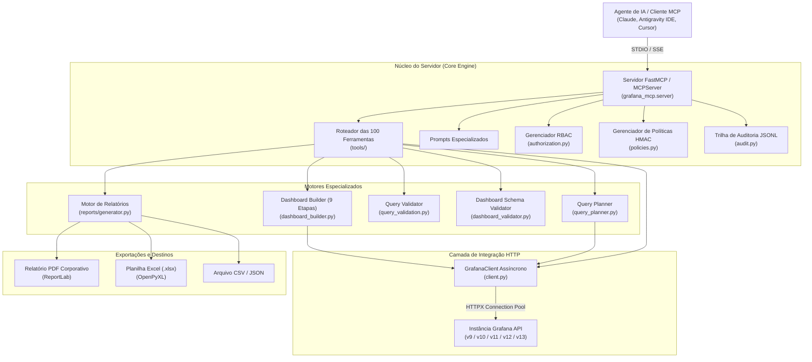

# 🏛️ Arquitetura do Grafana MCP Server

O **Grafana MCP Server** foi projetado seguindo os princípios de alta coesão, baixo acoplamento, observabilidade e segurança defensiva para suportar operação em ambientes corporativos de grande porte.

---

## 1. Diagrama Arquitetural Geral

---

## 2. Camadas do Sistema

### 1. Camada de Apresentação (MCP Interface)
- Implementa o protocolo MCP utilizando a biblioteca oficial `mcp` (v2.x / MCPServer).
- Oferece suporte nativo a dois modos de transporte:
  - **`stdio`:** Comunicação via pipes padrão para integração com IDEs locais (Claude Desktop, Antigravity IDE, Cursor).
  - **`sse`:** Transporte HTTP Server-Sent Events para execução em rede, Kubernetes ou contêineres Docker.

### 2. Camada de Segurança e Governança
- **RBAC (Role-Based Access Control):** Classifica cada ferramenta em `somente_leitura`, `operacional` ou `administrativo`.
- **Two-Phase Approval (HMAC-SHA256):** Ações de exclusão exigem geração de token criptográfico com TTL de 15 minutos, impedindo que agentes executem deleções acidentais.
- **Auditoria Local:** Registra todas as ações executadas em `audit_grafana_mcp.jsonl` com timestamp ISO 8601, parâmetros e tempo de execução em milissegundos.
- **Redação Automática de Credenciais:** Tokens, senhas e headers sensíveis são limpos antes de qualquer saída de log ou resposta.

### 3. Camada de Motores Especializados
- **Dashboard Builder:** Executa a orquestração em 9 fases para transformar prompts simples em dashboards prontos na API.
- **Query Validator:** Valida expressões PromQL, LogQL e aplica restrição estrita de leitura (`SELECT`/`WITH`) em fontes relacionais SQL.
- **Report Engine:** Renderiza relatórios corporativos multi-formato (PDF com tabelas e sumários, planilhas Excel XLSX e exportações estruturadas).

### 4. Camada de Transporte HTTP
- Utiliza `httpx.AsyncClient` com pool de conexões persistentes (*keep-alive*).
- Implementa controle de concorrência por semáforo assíncrono (`asyncio.Semaphore`).
- Mecanismo de retry automático com backoff exponencial para resiliência contra oscilações de rede.
