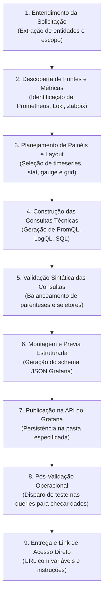

# 🎨 Motor Autônomo de Criação de Dashboards por Prompt (9 Estágios)

O **Grafana MCP Server** inclui um motor especializado capaz de transformar solicitações em linguagem natural em dashboards Grafana profissionais, validados e publicados na API através de **9 estágios sequenciais**.

---

## O Fluxo dos 9 Estágios

---

## Detalhamento dos Estágios

### Estágio 1: Entendimento da Solicitação
O motor analisa o texto em linguagem natural fornecido pelo usuário (ex: *"Crie um dashboard para monitorar servidores Linux com uso de CPU, memória RAM, disco e tráfego de rede"*), extraindo o domínio (infraestrutura, banco de dados, aplicação), granularidade temporal e métricas requeridas.

### Estágio 2: Descoberta de Fontes e Métricas
Consulta as fontes de dados cadastradas na instância do Grafana. Se houver Prometheus disponível, prioriza métricas do `node_exporter`. Se a fonte for Zabbix, mapeia para as chaves nativas do agente Zabbix (`system.cpu.util`, `vm.memory.util`, `vfs.fs.size`).

### Estágio 3: Planejamento de Layout e Painéis
Organiza a distribuição visual na grade de 24 colunas do Grafana:
- **Linha 1 (Topo):** Indicadores de resumo executivo (*stat cards* ou *gauges*) com largura 6 ou 8.
- **Linha 2 (Meio):** Séries temporais detalhadas (*timeseries*) de CPU e Memória com largura 12.
- **Linha 3 (Fundo):** Gráficos de tráfego de rede ou tabelas com largura 24.

### Estágio 4: Construção das Consultas Técnicas
Compõe as fórmulas exatas de acordo com a tecnologia identificada:
- **CPU (Prometheus):** `100 - (avg by (instance) (rate(node_cpu_seconds_total{mode="idle"}[5m])) * 100)`
- **Memória (Prometheus):** `(1 - (node_memory_MemAvailable_bytes / node_memory_MemTotal_bytes)) * 100`
- **CPU (Zabbix):** `system.cpu.util`

### Estágio 5: Validação Sintática das Consultas
Executa verificação estática nas expressões PromQL/LogQL/SQL garantindo:
- Parênteses e chaves balanceadas.
- Presença de seletores de streams em LogQL.
- Ausência de palavras-chave destrutivas em consultas SQL.

### Estágio 6: Montagem e Prévia Estruturada
Gera o modelo JSON completo com `schemaVersion: 39`, `timezone: browser`, `editable: true` e posicionamento `gridPos: {x, y, w, h}` sem sobreposições.

### Estágio 7: Publicação na API
Dispara requisição `POST /api/dashboards/db` vinculando o dashboard à pasta indicada e gerando o primeiro commit no controle de versão do Grafana.

### Estágio 8: Pós-Validação Operacional
Executa chamadas imediatas em `/api/ds/query` com os targets recém-publicados para certificar que a fonte está retornando dados reais e sem erros 4xx/5xx.

### Estágio 9: Entrega e Link Direto
Gera a URL direta e clicável para o dashboard:
`http://192.168.0.107:3000/d/linux-srv-mon/linux-servers-monitoring`
Fornecendo orientações de uso para o operador.
